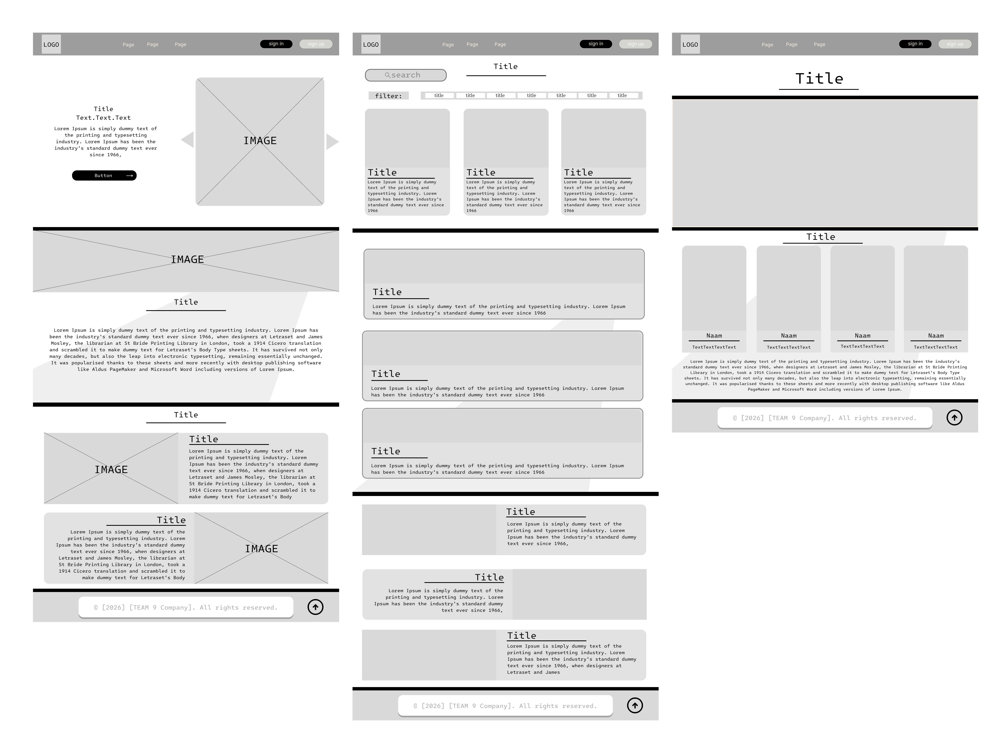
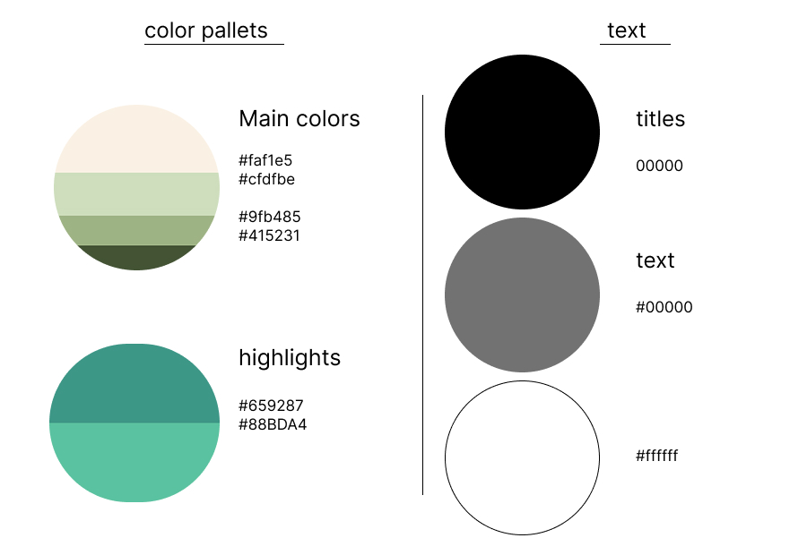
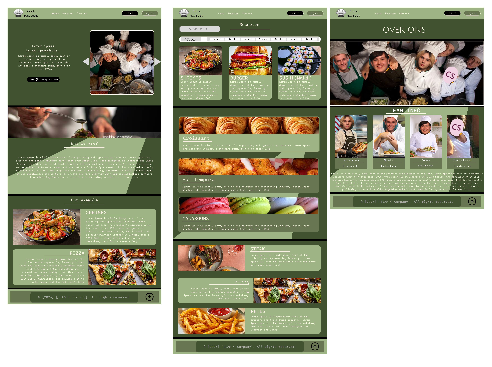

# Fase 4: Prototype (Ontwerp & Techniek)

Team 9: Yaroslav, Niels, Sven en Christiaan

## 1. Wireframes (Lo-Fi)

Eerst hebben we wireframes gemaakt in Figma. Dit zijn simpele grijze schetsen zonder kleur en zonder echte foto's. Zo konden we eerst de indeling van de pagina's bepalen.

### Op elke pagina

- Bovenaan een header met het logo, het menu (Home, Recepten, Over ons) en de knoppen sign in en sign up.
- Onderaan een footer met de copyright-tekst en een knop om terug naar boven te gaan.
- De titels staan in het midden met een streep eronder.

### Homepage

- Bovenaan een titel, een stukje tekst en de knop "Bekijk recepten". Rechts staat een grote afbeelding met pijltjes om door de afbeeldingen te gaan.
- Daaronder een brede afbeelding.
- Dan het stuk "Who we are?" met uitleg over ons.
- Als laatste "Our example" met twee gerechten (afbeelding en tekst), de ene links en de andere rechts.

### Receptenpagina

- Bovenaan een zoekbalk en een filterbalk.
- Daaronder receptkaarten naast elkaar met een foto, titel en korte tekst.
- Daarna brede kaarten onder elkaar.
- Onderaan gerechten met foto en tekst naast elkaar, links en rechts afwisselend.

### Over ons

- Een titel en een grote teamfoto.
- Daaronder "Team info" met 4 kaarten: Yaroslav (Frontend dev), Niels (Backend dev), Sven (Backend dev) en Christiaan (Frontend dev).
- Onderaan een stukje tekst over ons team.

### Inloggen en registreren

De knoppen sign in en sign up staan in de header op elke pagina. Het formulier is simpel: e-mail, gebruikersnaam en wachtwoord.

## 2. Visual Design (Hi-Fi)

Daarna hebben we de wireframes mooi gemaakt met kleuren, echte foto's en lettertypes. We wilden dat de website rustig en fris voelt, zoals een keuken met verse kruiden. Daarom hebben we veel groen gebruikt.

### Kleuren

| Waar voor | Kleur | Hex |
|---|---|---|
| Hoofdkleur 1 (licht) | Crème | #FAF1E5 |
| Hoofdkleur 2 | Lichtgroen | #CFDFBE |
| Hoofdkleur 3 | Saliegroen | #9FB485 |
| Hoofdkleur 4 (donker) | Donkergroen | #415231 |
| Highlight 1 | Grijsgroen | #659287 |
| Highlight 2 | Mintgroen | #88BDA4 |
| Titels | Zwart | #000000 |
| Tekst | Grijs | #737373 |
| Tekst op donker | Wit | #FFFFFF |

Donkergroen gebruiken we voor de achtergrond. Saliegroen gebruiken we voor de header, de footer en de kaarten. De highlights gebruiken we voor kleine details en knoppen.

### Lettertype

- **Titels en tekst:** een monospace lettertype (als een typemachine).
- **Menu en knoppen:** Inter.

### Foto's en vormen

- We gebruiken echte foto's van eten en van koks.
- Kaarten, knoppen en foto's hebben ronde hoeken.
- Achter de tekst zit een schuin vlak in een lichtere kleur.
- Ons logo is een koksmuts met de naam Cook masters.

### Hi-Fi ontwerpen

## 3. Technische architectuur

- **Frontend:** HTML, CSS en JavaScript. We maken de website eerst voor mobiel (mobile first).
- **Backend en database:** PHP en SqLite voor de recepten en de gebruikers (inloggen en registreren).
- **Hosting:** Plesk
- **Versiebeheer:** Git en GitHub.
- **Ontwerp:** Figma.

De frontend wordt gemaakt door Yaroslav en Christiaan. De backend wordt gemaakt door Niels en Sven.
